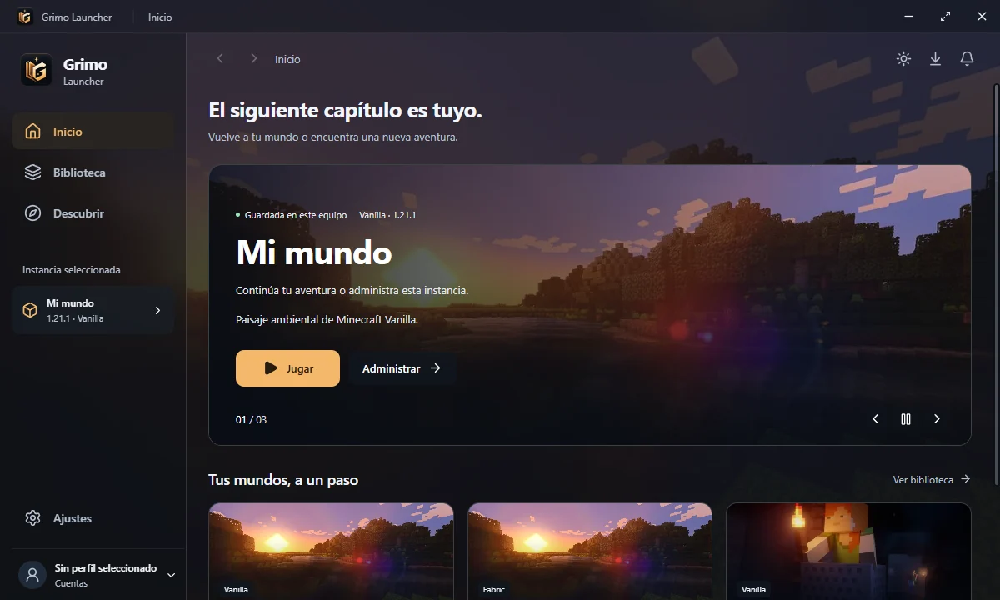

<h1 align="center">
  <picture>
    <source media="(prefers-color-scheme: dark)" srcset="launcher/branding/copper/wordmark-dark.png">
    
  </picture>
</h1>

<p align="center"><strong>Minecraft Java, a tu manera.</strong><br>
Una biblioteca para tus versiones, modpacks y mundos en Windows 10 y 11 (x64).</p>

<p align="center">
  <strong><a href="https://github.com/Jeremy-Godoy-D/Launcher-MC/releases/download/v0.3.0-beta.1/GrimoLauncher-0.3.0-beta.1-win-x64.exe">Descargar para Windows</a></strong>
  · <a href="https://github.com/Jeremy-Godoy-D/Launcher-MC/releases/download/v0.3.0-beta.1/GrimoLauncher-0.3.0-beta.1-win-x64.zip">ZIP portable</a>
  · <a href="https://github.com/Jeremy-Godoy-D/Launcher-MC/releases/tag/v0.3.0-beta.1">Notas de v0.3.0-beta.1</a>
</p>

<p align="center">
  <a href="#tu-primera-instancia">Primeros pasos</a>
  · <a href="#actualizar-y-conservar-tus-mundos">Actualizar</a>
  · <a href="#cómo-funciona">Arquitectura</a>
  · <a href="#desarrollo">Desarrollo</a>
</p>

<p align="center">
  <picture>
    <source media="(prefers-reduced-motion: no-preference)" srcset="docs/media/grimo-recorrido.webp" type="image/webp">
    
  </picture>
  <br><sub>Inicio → Biblioteca → Mundos · Capturas de la beta con datos de demostración</sub>
</p>

## Tu primera instancia

Una instancia reúne una versión de Minecraft, su loader, sus mods y su configuración. Puedes tener una partida Vanilla y un modpack en la misma biblioteca, cada uno con su propio entorno.

1. **Abre Grimo y crea un perfil local.** La beta admite perfiles locales. El inicio de sesión con Microsoft queda pospuesto.
2. **Entra en Biblioteca → Añadir instancia.** Elige una versión de Minecraft y un loader, o importa un modpack compatible en `.mrpack` o `.zip`.
3. **Pulsa Jugar.** Grimo comprueba qué Java necesita esa instancia. Si falta una versión compatible, puede descargarla e instalarla en el almacenamiento del launcher. Usa **Ajustes** de la instancia para seleccionar Java manualmente o ajustar la RAM.

| Quiero… | Dónde hacerlo |
| --- | --- |
| Volver a mi última partida | **Inicio** muestra la instancia seleccionada y su botón **Jugar**. |
| Organizar mis instalaciones | **Biblioteca** tiene búsqueda, filtros por loader, grupos y acciones para duplicar o exportar instancias. |
| Encontrar un modpack, mod, pack o shader | **Descubrir** reúne las búsquedas de Modrinth y CurseForge. Dentro de la instancia, usa **Mods**, **Packs** o **Shaders** para administrar lo instalado. |
| Gestionar mis partidas | **Mundos** permite importar, copiar y exportar partidas, compartirlas entre instancias y consultar el progreso, el mapa, las regiones y los chunks. |
| Diagnosticar un arranque | **Consola** muestra la salida del juego. En **Ajustes** puedes revisar Java, la memoria y los argumentos JVM. |

**Versiones y loaders.** Vanilla, Fabric, Forge, NeoForge, Quilt, OptiFine y LabyMod. La disponibilidad de cada loader depende de la versión de Minecraft. Para OptiFine, selecciona BMCLAPI en **Ajustes → Red y descargas**. [Pruebas de arranque de la beta](docs/react-migration/STAGE9-LIVE.md).

**Apariencia.** La interfaz combina superficies de cristal con paisajes de Minecraft. Los modpacks usan las imágenes de sus propios metadatos cuando están disponibles. Puedes elegir tema claro, oscuro o del sistema, activar el movimiento reducido y usar el modo rendimiento.

## Instalar

| Formato | Uso |
| --- | --- |
| [Instalador Windows x64](https://github.com/Jeremy-Godoy-D/Launcher-MC/releases/download/v0.3.0-beta.1/GrimoLauncher-0.3.0-beta.1-win-x64.exe) | Ejecuta el `.exe`, elige la carpeta del programa y abre Grimo desde su acceso directo. |
| [ZIP portable x64](https://github.com/Jeremy-Godoy-D/Launcher-MC/releases/download/v0.3.0-beta.1/GrimoLauncher-0.3.0-beta.1-win-x64.zip) | Extrae todo el ZIP en una carpeta y ejecuta `Grimo Launcher.exe` desde allí. |

El ejecutable de esta beta carece de firma Authenticode. Windows puede mostrar un aviso de editor desconocido. Descarga la versión desde las publicaciones oficiales y compara su suma SHA-256 si quieres comprobar la integridad del archivo. [Todas las versiones](https://github.com/Jeremy-Godoy-D/Launcher-MC/releases).

<details>
<summary>Comprobar el SHA-256 del instalador en PowerShell</summary>

Desde la carpeta donde guardaste el instalador, ejecuta este comando y compara el resultado con la suma publicada. Si difiere, vuelve a descargar el archivo oficial antes de ejecutarlo.

```powershell
Get-FileHash -Algorithm SHA256 -LiteralPath .\GrimoLauncher-0.3.0-beta.1-win-x64.exe
```

[SHA-256 del EXE](https://github.com/Jeremy-Godoy-D/Launcher-MC/releases/download/v0.3.0-beta.1/GrimoLauncher-0.3.0-beta.1-win-x64.exe.sha256) · [SHA-256 del ZIP](https://github.com/Jeremy-Godoy-D/Launcher-MC/releases/download/v0.3.0-beta.1/GrimoLauncher-0.3.0-beta.1-win-x64.zip.sha256)

</details>

## Actualizar y conservar tus mundos

**De Launcher MC `v0.2.0-beta.2` a Grimo `v0.3.0-beta.1`**

1. En Launcher MC abre **Ajustes → Acerca de → Ver actualización → Descargar instalador (.exe)**. El navegador debe ofrecer `GrimoLauncher-0.3.0-beta.1-win-x64.exe`. Si tu versión anterior muestra una página de texto al descargar, usa el [instalador oficial de Grimo](https://github.com/Jeremy-Godoy-D/Launcher-MC/releases/download/v0.3.0-beta.1/GrimoLauncher-0.3.0-beta.1-win-x64.exe).
2. Localiza tus datos en **Ajustes → General → Ubicación del almacenamiento**. Cierra Minecraft y el launcher. Respalda esa carpeta, las instancias guardadas en otras ubicaciones y `%APPDATA%\LauncherMC`.
3. Ejecuta el instalador completo y selecciona la misma carpeta del **programa**. Si usas la versión portable, extrae el nuevo ZIP completo en una carpeta de programa y conserva la ubicación de tus **datos**.
4. Abre Grimo y comprueba tu biblioteca, tu perfil y los mundos locales y compartidos desde **Biblioteca → Administrar → Mundos**.

La instalación sobre beta.2 se probó en Windows desechable. Conservó la instancia seleccionada, un mundo, el perfil local, la memoria y la ubicación del almacenamiento. [Evidencia del instalador](docs/react-migration/STAGE9-INSTALLER.md).

<details>
<summary>¿Dónde están mis instancias y mis mundos?</summary>

La **ubicación del almacenamiento** que elegiste en Ajustes contiene las instancias gestionadas y la carpeta común de mundos. Una instancia local guarda sus partidas en `saves`. El almacenamiento compartido usa `saves` en la raíz de datos. Si vinculaste una instancia externa, conserva también esa carpeta.

`%APPDATA%\LauncherMC` contiene el perfil de la aplicación y la referencia al almacenamiento elegido. El nombre histórico de esa ruta se mantiene por compatibilidad.

</details>

<details>
<summary>¿Por qué esta actualización usa un instalador completo?</summary>

El launcher descubre la beta desde GitHub Releases. El paso de Launcher MC a Grimo usa la distribución completa de Windows y descarga el EXE mediante el navegador. En Grimo puedes consultar futuras versiones desde **Ajustes → Actualizaciones**. [Publicación verificada](docs/react-migration/STAGE9-PUBLICATION.md).

</details>

## Cómo funciona

La interfaz React muestra los datos y solicita operaciones mediante contratos IPC. El proceso principal de Electron conecta esas solicitudes con los servicios que leen las instancias, administran archivos y arrancan Minecraft.

| Componente | Responsabilidad |
| --- | --- |
| [`xmcl-react-ui`](launcher/xmcl-react-ui) | Interfaz React, TypeScript y Vite para el launcher, la consola y los asistentes. |
| [`renderer-client`](launcher/packages/renderer-client) | Cliente tipado para servicios, estado y tareas. |
| [`xmcl-electron-app`](launcher/xmcl-electron-app) | Proceso principal, ventanas, preload, distribución NSIS y actualizador. |
| [`xmcl-runtime`](launcher/xmcl-runtime) y [`xmcl-runtime-api`](launcher/xmcl-runtime-api) | Servicios y contratos para instancias, Java, cuentas, mundos, catálogo y lanzamiento. |
| [`curseforge-proxy`](services/curseforge-proxy/README.md) | Worker de Cloudflare que restringe las peticiones de CurseForge y mantiene la clave como secreto del servidor. |
| [`xmcl-keystone-ui`](launcher/xmcl-keystone-ui) | Interfaz Vue histórica que sirve de referencia para compatibilidad. |

Grimo se centra en Minecraft Java y reutiliza los servicios de XMCL que necesita. La matriz de paridad documenta el alcance de cada herramienta y las funciones históricas que quedaron fuera o se pospusieron. [Matriz de paridad](docs/react-migration/PARITY.md) · [Validación de la versión](docs/react-migration/STAGE9-VALIDATION.md) · [Revisión de seguridad](docs/react-migration/STAGE9-SECURITY.md).

## Desarrollo

El workspace usa **Node.js 22.16 o posterior** y **pnpm 11.10.0**. Desde la raíz de un clon:

```powershell
cd launcher
pnpm install --frozen-lockfile
pnpm dev:renderer
```

En una segunda terminal, desde `launcher/`, ejecuta `pnpm dev:main`. El proceso principal abre la interfaz de Vite en `http://localhost:3000`.

| Tarea | Comando desde `launcher/` |
| --- | --- |
| Tipos y lint | `pnpm check` y `pnpm lint` |
| Pruebas unitarias | `pnpm exec vitest run` |
| Preparar el bundle de Electron | `pnpm build:renderer` y `pnpm --prefix=xmcl-electron-app compile` |
| Ejecutar las pruebas Electron | Instala las herramientas con `pnpm e2e:install`. El flujo de CI documenta cómo arrancar el paquete de React y ejecutar su suite. |
| Empaquetar para Windows | `pnpm build:renderer` y `pnpm build:all`. Los archivos quedan en `xmcl-electron-app/build/output/`. |

Para probar CurseForge en desarrollo, configura el origen HTTPS público del proxy mediante `CURSEFORGE_PROXY_URL`. La clave de CurseForge se configura como secreto del Worker. [Configuración del proxy](services/curseforge-proxy/README.md).

[Guía de contribución](launcher/CONTRIBUTING.md) · [CI de React](.github/workflows/react-migration.yml) · [Flujo de publicación](.github/workflows/release.yml) · [Reportar un problema](https://github.com/Jeremy-Godoy-D/Launcher-MC/issues)

## Licencia y créditos

Grimo Launcher está bajo licencia MIT. Lo mantiene Jeremy Godoy y utiliza la base de [X Minecraft Launcher](https://github.com/Voxelum/x-minecraft-launcher). Minecraft es una marca de Mojang. Grimo es un proyecto independiente, sin afiliación con Mojang ni Microsoft.

[Licencia MIT](LICENSE) · [Avisos](NOTICE) · [Licencias de terceros](launcher/THIRD_PARTY_NOTICES.txt)

<details>
<summary>Créditos del recorrido visual</summary>

Capturas de la interfaz de Grimo en la beta `v0.3.0-beta.1`, con nombres y partidas de demostración. La vista animada combina tres capturas con transiciones breves. La preferencia de movimiento reducido muestra una captura fija.

Los fondos aparecen recortados y oscurecidos por la interfaz. **Minecraft shaders graphiques**, por downloadsource.fr. [Original](https://www.flickr.com/photos/128776630@N02/16180013416) · [CC BY 2.0](https://creativecommons.org/licenses/by/2.0/).

**Minecraft Caves & Cliffs: Part II**, por Xbox MENA. [Fuente y atribuciones de los recursos visuales](launcher/xmcl-react-ui/src/assets/ambient/credits.json) · [CC BY 3.0](https://creativecommons.org/licenses/by/3.0/).

</details>
